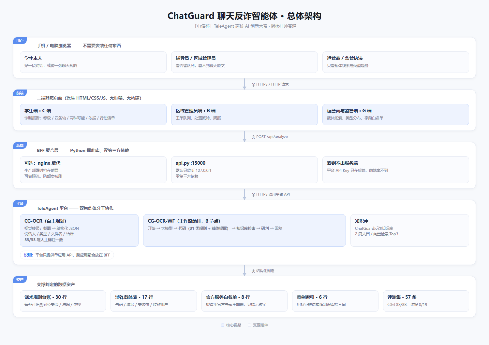

# ChatGuard · 聊天反诈智能体

> 这曾是一个比赛项目，可惜我演讲没讲好，所以没拿奖，现在整理并开源。

> 把一段可疑聊天（或一张截图）贴进来，约 20–35 秒，返回一张诊断报告：
> **对方想干什么、你走到哪一步、两种可能分别是什么、现在该做什么。**
>
> 不是"判定是不是诈骗"，而是**在钱出去之前把话说清楚**。

---

## 三个数字

| 指标 | 数值 |
|---|---|
| 评测集 | **57 条**（30 标准集 + 15 holdout + 12 holdout v2） |
| 召回 | **38 / 38** |
| 误报 | **0 / 19** |

> 负样本 19 条里 17 条判 `low`、2 条判 `medium`、**没有一条到 `high`/`critical`** ——
> 说明系统不是"见谁都报警"。

---

## 它解决什么问题

反诈宣传已经做了很多年，为什么还有人被骗？

我们的观察是：**最需要判断的那一刻，恰恰是判断能力最弱的时候。**

一个人收到"垫付三单、连本带利返"的时候，心里其实有疑问，但不好意思问，也没人能马上问。

现有的反诈工具（来电拦截、关键词审核、问答式助手）都解决不了**一段具体的、正在进行中的对话**。
所以我们做了这个：分析你手上这一段聊天，告诉你现在该做什么。

---

## 架构



```
浏览器（三端页面）
   │ POST /api/analyze
   ▼
后端 api.py（BFF，Python 标准库，零第三方依赖）
   │ ① 文件上传  ② 视觉转录  ③ 研判工作流
   ▼
TeleAgent 平台
   ├─ CG-OCR         自主规划应用 · 截图 → 结构化 JSON
   └─ CG-OCR-WF      工作流：开始 → 大模型 → 代码 → 知识库检索 → 研判 → 回复
```

**为什么需要后端**（三层原因，缺一不可）：

1. 平台的每个应用只有单一端点，需要把"视觉转录"和"研判"两个应用串起来；
2. 视觉能力只在 agent-chat 应用内可用，工作流里传不进图片，必须由后端中转；
3. **API Key 不能落在前端**——否则任何人拿到页面就能刷额度。

---

## 目录结构

```
shell/            前端页面 + 后端
  index.html      学生端（C 端）
  admin.html      区域管理员端（B 端）
  report.html     运营商 / 监管端（G 端）
  demo.html       三端导航
  api.py          后端（BFF）
  mock_data.py    演示样例数据（仅在显式开启样例模式时使用）
backend/          规则引擎（平台「代码」节点的源码）
kb/               知识库文档 + 4 张数据表（CSV）
tests/            57 条评测集 + 评测脚本
docs/             架构图、数据来源说明、三个提示词全文
```

---

## 快速开始

### 1. 准备

- Python 3.7+
- 一个 [TeleAgent 平台](https://agent.teleai.com.cn) 账号

### 2. 在平台上建两个应用

| 应用 | 类型 | 模型 | 提示词 |
|---|---|---|---|
| `CG-OCR` | 自主规划（agent-chat） | Qwen3.7-Plus（视觉） | [`docs/prompts/01_视觉转录.md`](docs/prompts/01_视觉转录.md) |
| `CG-OCR-WF` | 工作流（advanced-chat） | Qwen3.7-Plus | [`docs/prompts/02_文本规范化.md`](docs/prompts/02_文本规范化.md) + [`03_研判.md`](docs/prompts/03_研判.md) |

工作流节点顺序：

```
开始(chat_text) → 大模型 → 代码 → 知识库检索 → 研判 → 回复
```

- **代码节点**：粘贴 `backend/code_node_rules.py`，输入变量 `transcript ← 大模型.text`
- **知识库检索**：上传 `kb/` 下两篇文档，TopK 3、阈值 0.5、混合检索
- **研判节点**：输入 `kb1.result` + 代码节点 `payload`

### 3. 配置密钥

```bash
cp .env.example .env      # 填入你自己的两个 App Key
```

或直接：

```bash
export CG_OCR_KEY=app-xxxx
export CG_WF_KEY=app-yyyy
python shell/api.py --open
```

浏览器会自动打开 `http://127.0.0.1:15000/`。

> **没有 Key 也能启动服务**：页面正常显示，分析会明确提示密钥缺失，不会静默失败。

### 4. 走一遍

- 学生端：贴一段对话 → 开始分析（约 20 秒）
- 学生端：上传截图 → 约 35 秒
- 区域管理员端：看到刚才那条分析变成的工单（看不到原文）
- 运营商端：看到提取出的载体线索

---

## 测试与评测

```bash
# 规则层自测（不花额度，几秒钟）
cd backend && python test_rules.py --file ../tests/holdout_v2.json -v

# 端到端评测（每条约 10 资源点）
cd tests && python run_eval.py --file holdout_v2.json
```

**已知结果**（2026-11-19 实测）：

| 数据集 | 规则层覆盖 | 端到端召回 | 误报 |
|---|---|---|---|
| `cases.json`（30） | 100% | 20/20 | 0/10 |
| `holdout.json`（15） | 100%（已被调优污染） | 10/10 | 0/5 |
| `holdout_v2.json`（12） | **38%** | 8/8 | 0/4 |

> **`holdout.json` 的 100% 不可信**：我们在看到它的漏项后补过规则，它已经不再是"没见过的数据"。
> `holdout_v2` 是随后专门构造的干净集，**38% 才是诚实的规则覆盖率**。

---

## 设计取舍（这部分说明我们为什么这么做）

### 规则不做召回，只做线索

关键词规则在全新类型上只能覆盖 **38%**——"免费领养布偶猫，你先垫个运费"一个关键词都没有。

**但我们不靠规则召回。** 规则负责两件模型做不好的事：**可解释**（告诉用户因为出现了什么）和**载体提取**（正则抽号码、域名）。判定交给研判模型。

### 强制两种可能并列

反诈工具最大的风险不是漏判，是**谄媚**——用户怀疑什么，它就说什么。

提示词第 5 条明确禁止二选一：技术特征（可疑脚本名、涉密文件名）与关系语境（亲昵称呼、小额往来）冲突时，**必须给出至少 2 个并列假设**，各自标注支持与反对证据。

### 事件上行，原文不上行

学生之所以敢用，是因为系统没有把他的话拿去上报。

校园端只能看到：匿名编号、类型、等级、时间、建议动作、载体。
**聊天原文一个字都不落盘**（原文只存在于平台侧那一次模型调用中）。

### 工具调用：主动不用

平台的智能体特性四项（工具调用 / 知识库 / 工作流编排 / 多轮交互），我们用了后三项。

**没用的那一项是刻意的**：输入是聊天文本，没有必须调外部接口的环节。硬塞一个天气查询只会增加故障点。

---

## 已知限制

| 限制 | 说明 |
|---|---|
| 依赖平台额度 | 平台每日有资源点上限，额度耗尽会明确报错（不降级） |
| 视觉只在 agent-chat 可用 | 工作流节点传不进图片，所以必须两段式调用 |
| 图片较慢 | 截图约 35 秒（两次模型调用），文本约 20 秒 |
| 不构成法律结论 | 所有输出都带 disclaimer，需人工复核 |

---

## 数据与隐私

- 所有测试对话均为**公开案例的改写**（法院、公安部、央视），不含真实个人信息
- 仓库中的 `shell/sample_A.jpg` 是**团队自行构造的示例截图**，不是任何真实用户的聊天记录
- 详细的来源与合规说明见 [`docs/18_测试数据来源.md`](docs/18_测试数据来源.md)

---

## 许可

[MIT](LICENSE)

---

## 致谢

- 公安部刑侦局《防范电信网络诈骗宣传手册》、国家反诈中心
- 乌审旗人民法院高校真实案例
- 央视"杀猪盘"案件报道
- TeleAgent（星辰智能体平台）
